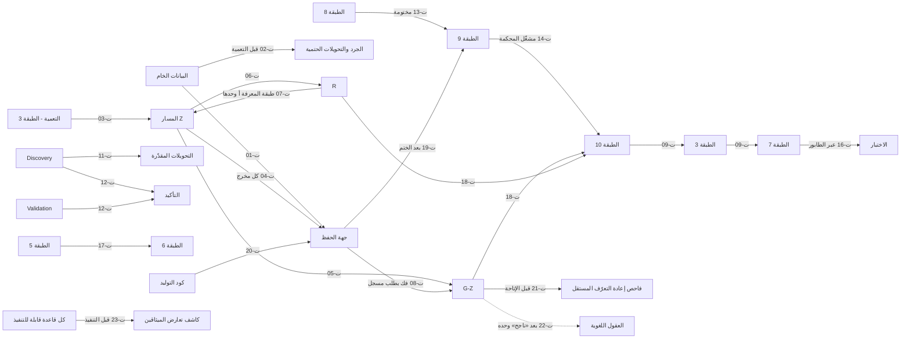

# المرحلة 7 — WP7-02: مواصفة تدفق البيانات (النسخة 01)

**التاريخ:** 2026-11-13.
**الإذن:** «أأذن بالسبعة» (2026-11-13)، وأمر المؤسس بعد §15 من سجل الحسم.
**تعريف الحزمة (خطة التنفيذ 07، §3.2):** «مواصفة تدفق البيانات من القواعد القائمة: §2 (المعرفة لا تعود من 10 إلى 7 إلا عبر 3)، و§5 (R ← Z ممنوع)، و§3.1.2 (كل مخرج من Z يمر بجهة الحفظ)، و§7 و§8.2». **معيار القبول:** «لا اتجاه غير منصوص».
**نقل قرارات §24 (بإذن المؤسس، 2026-11-13):** ت-02، ت-08، ت-13، ت-15، ت-16، وأُضيفت ت-17 إلى ت-20؛ و§3 و§5. **وبقي غير مرسوم: إعادة تعمية مخرجات G-Z (ق-25، ق-28).**
**نقل قرارات §25 (بإذن المؤسس المباشر، 2026-11-13):** أُضيفت ت-21 إلى ت-23، و§4 و§5. **والجهة التي تتيح الحزمة بعد الفحص [إضافة مقترحة] تحتاج اعتمادًا** (WP7-01 §3.2).
**نقل قرارات §26 (التدقيق، 2026-11-13):** اعتُمدت الإضافات في ت-21 إلى ت-23 بقيودها؛ وغ-03 في ت-22؛ وغ-04 في ت-23.
**الحالة:** مسودة للتدقيق. وثيقة نصية فقط. لا تعدّل ملفًا مجمّدًا.
**الجولة 11 (تعديل في الموضع، دون إعادة كتابة):** الملاحظة 2: ت-04 صار «كل مخرج من Z» وحده، وفُصلت قائمة المرشح (س 277–284) وشرط الفحص (س 255) تحت الجدول.
**المصادر والقواعد:** كما في WP7-01، §0 (`STAGE7_SPEC_COMPONENTS_01.md`، `27fea3ed…483b`). **وكل سهم هنا له سند؛ والسهم الذي لا سند له لا يُرسم.**

## 0. تصحيح صياغة في تعريف الحزمة (لا يغيّر النطاق)
تعريف الحزمة يكتب «R ← Z ممنوع». **ونص المرشح:** «من R إلى Z ممنوع إلا عبر الطبقة (أ)» ⟨س 354⟩. **فالممنوع اتجاه R إلى Z، باستثناء منصوص،** و«الطبقة (أ)» هي طبقة المعرفة (أ) (س 357)، لا الطبقة المعمارية 3 (المرشح عند س 360). **وتعمل هذه المواصفة بنص المرشح.**

## 1. التدفقات المسموحة
| # | من | إلى | ما يتدفق | الشرط | السند |
|---|---|---|---|---|---|
| ت-01 | البيانات الخام | جهة الحفظ | البيانات الخام | «جهة الحفظ وحدها تلمس البيانات الخام» | «جهة الحفظ وحدها تلمس البيانات الخام» ⟨س 352⟩ |
| ت-02 | البيانات الخام | الجرد والتحويلات الحتمية (الطبقة 4) | البيانات الخام | **قبل التعمية.** ومنفّذه جهة الحفظ في حدود الجرد والتحويلات المجمدة ⟦قرار المؤسس، سجل 7 §24 ق-10⟧. ولا جرد قبل إذن الجرد (م3-02) | ⟦قرار المؤسس⟧ سجل 7، §13 #13، #14؛ س 398 |
| ت-03 | التعمية (الطبقة 3) | المسار Z | تمثيلات معمّاة (§3.1.1) | «قبل أي وصول من المسار Z»؛ ولا تُتاح معًا إلا مجموعة اجتازت الاختبار المشترك، **والمجموعات نفسها مفتوحة حتى قرار المؤسس بعد الاختبار المشترك** | «التعمية (§3.1) تُطبَّق قبل أي وصول من المسار Z» ⟨س 352⟩؛ س 245؛ سجل 7، §13 #30 |
| ت-04 | المسار Z | جهة الحفظ | كل مخرج من Z | قبل وصوله إلى أي طرف آخر | «كل مخرج من Z يمر على جهة الحفظ قبل أن يصل إلى أي طرف آخر» ⟨س 254⟩؛ ⟦قرار المؤسس⟧ م-01 (العقول اللغوية داخل Z) |
| ت-05 | المسار Z | G-Z | — | مسموح | «التدفق من Z إلى G-Z وR مسموح» ⟨س 354⟩ |
| ت-06 | المسار Z | R | — | مسموح | س 354 |
| ت-07 | R | Z | معرفة من طبقة المعرفة (أ) **وحدها** | والملاحظة من بيانات الذهب تعبر **موسومة «خاصة»** | «من R إلى Z ممنوع إلا عبر الطبقة (أ)» ⟨س 354⟩؛ ⟦قرار المؤسس⟧ CS-01-08 |
| ت-08 | جدول فك التعمية (جهة الحفظ) | G-Z | ناتج الفك | جهة الحفظ وحدها تنفّذ الفك بطلب مسجل من المسار، وتعيد الناتج؛ ولا يحمل G-Z الجدول. ⟦قرار المؤسس، سجل 7 §24 ق-01⟧ **G-Z يتلقى نتائج فك محصورة في الزمن والتقويم الحقيقيين، ولا يرى الخام ولا الجدول ولا المعاملات** | س 355، 791؛ ⟦قرار المؤسس⟧ م7-10 البند 2 |
| ت-09 | الطبقة 10 | الطبقة 7 | المعرفة | **عبر الطبقة 3 وحدها:** يُوسم بصنفه وحالة ZERO-PRIOR؛ ويُعمّى إن كان المستقبِل Z؛ ويُسجَّل كل مرور في النسب | «المعرفة لا تعود من الطبقة 10 إلى الطبقة 7 إلا عبر الطبقة 3» ⟨س 131⟩؛ ⟦قرار المؤسس⟧ سجل 7، §13 #4–#6 |
| ت-10 | عقل | عقل | أي تبادل | عبر **قناة مسجلة**، وكل استعمال حدث في النسب؛ ولا اطلاع على فرضيات عقل آخر في العائلة قبل تجميد فرضيته | ⟦قرار المؤسس⟧ م-04، البندان 1 و2 |
| ت-11 | Discovery | التحويلات المقدّرة | تقديرات المعاملات | «من Discovery فقط» | «ومقدّرة من Discovery فقط» ⟨س 399⟩ |
| ت-12 | Discovery أو Validation | التأكيد | الاختيار | شرط فصل | «الاختيار من Discovery أو Validation» ⟨س 545⟩ |
| ت-13 | الطبقة 8 | الطبقة 9 | التسليمات | مختومة. ⟦قرار المؤسس، سجل 7 §24 ق-27، ق-22⟧ **حزمة مختومة يفتحها مشغّل المحكمة بإجراء مسجل، وتدخل الكود دون عرض حقولها عليه** | «التسليمات مختومة» ⟨س 2196⟩ |
| ت-14 | الطبقة 9 | الطبقة 10 | الأحكام كما أخرجها الكود | بمشغّل المحكمة | ⟦قرار المؤسس⟧ م7-03 البند 1 |
| ت-15 | جهة الحفظ | سجلها | التحويل بين المعاملات السرية القديمة والجديدة | عند التدوير وحده (س 260–261). ⟦قرار المؤسس، سجل 7 §24 ق-02⟧ **وحقبة التدوير: حدّان يعلنهما المؤسس مسبقًا، ولا يقع حدّ داخل عائلة مفتوحة** | س 262؛ سجل 7، §11 #14–#16 |
| ت-16 | العقول (الطبقة 7) | الاختبار | المقترحات | عبر الطابور وحراسته. ⟦قرار المؤسس، سجل 7 §24 ق-03، ق-29⟧ **ينتقل المعرّف وClaim ID والمسار ومرجع النسب وتسجيل النوع والمسار، بشروط أهلية ق-03؛ والمرور ليس قبولًا علميًا** | ⟦قرار المؤسس⟧ م7-13 البند 3 |
| ت-17 | الطبقة 5 | الطبقة 6 | سجل حدود الشرائح ومقاييسها والتصميم وقواعده، ببصمته | قبل تقرير الكفاية؛ ويتحقق مدقق الحفظ من وجوده إجرائيًا | ⟦قرار المؤسس، سجل 7 §24 ق-27⟧؛ س 431، 481 |
| ت-18 | G-Z وR | الطبقة 10 | رسائل بحقول إلزامية بحسب نوعها | Claim ID أو «لا ادعاء»؛ ووسم «خاصة» للملاحظة من بيانات الذهب (CS-01-08)؛ وتُرفض الرسالة الناقصة | ⟦قرار المؤسس، سجل 7 §24 ق-29⟧ |
| ت-19 | جهة الحفظ (الحقيقة المخفية) | مشغّل المحكمة | الحقيقة المخفية للعوالم المختومة | بعد ختم التسليمات وتجميد معايير المقارنة | ⟦قرار المؤسس، سجل 7 §24 ق-27⟧؛ م7-01 البند 1 |
| ت-20 | كود التوليد (يشغّله مصمم العوالم) | جهة الحفظ | الحقيقة المخفية | يكتبها الكود مباشرة، ولا تُعرض على المشغّل. **وضماناتها ض1 إلى ض3 متطلبات لا ضمانات متحققة** | ⟦قرار المؤسس، سجل 7 §24 ق-08⟧ |
| ت-21 | مخرجات G-Z (بعد إعادة تعميتها تحت ضبط الحفظ) | فاحص إعادة التعرّف المستقل | الحزمة المرشحة للإتاحة | قبل أي إتاحة؛ وبصيغة D-03. ⟦قرار ChatGPT بتفويض المؤسس، سجل 7 §26⟧ **ويرى الفاحص معها الحزم المتاحة قبلها وسجل تدقيق إعادة التعمية، ولا يرى الخام ولا جدول الربط ولا جدول الفك ولا المعاملات السرية** (WP7-01 §3.2) | ⟦قرار ChatGPT بتفويض المؤسس، سجل 7 §25 D-02، D-03⟧ |
| ت-22 | G-Z | العقول اللغوية | الحزمة المعاد تعميتها | **بعد نتيجة «ناجح» وحدها؛ والفاشل أو غير الحاسم أو المتعذّر تقديره لا يُتاح.** وجدول الربط لا ينتقل. ⟦قرار ChatGPT بتفويض المؤسس، سجل 7 §26⟧ **جهة الحفظ تتيحها؛ ولا إتاحة لأي مخرج حتى يُحسم «الحد المعلن» (CS-01-04) ويُتحقق من م5-20 تحققًا كافيًا** (غ-03) | ⟦قرار ChatGPT بتفويض المؤسس، سجل 7 §25 D-02، D-03⟧؛ ق-01 |
| ت-23 | كل قاعدة قبل تنفيذها | كاشف تعارض الميثاقين | نص القاعدة | **قبل التنفيذ؛ والمعارضة تُسجَّل ولا تُنفَّذ** (ق-21). ⟦قرار ChatGPT بتفويض المؤسس، سجل 7 §26⟧ **الموقوفة لا تُنفَّذ حتى تُسحب أو تُعدَّل ويُعاد فحصها أو يُعدَّل الميثاق بإجراء ق-21؛ وغير المفحوصة لا تُنفَّذ.** **و«القاعدة»: كل قاعدة تشغيلية أو حوكمية قابلة للتنفيذ تؤثر في الوصول أو البيانات أو التدفقات أو صلاحيات الأدوار أو الاختبار أو التقييم** (غ-04؛ WP7-01 §3.2) | ⟦قرار ChatGPT بتفويض المؤسس، سجل 7 §25 D-04⟧ |

**تفصيل ت-04 (نص المرشح وحده، لا قرارات جديدة):**
- **ما يشمله «كل مخرج»:** نطاق مراجعة التسرب في المرشح، حرفيًا: «مخرجات المحركات» ⟨س 277⟩؛ «الرسوم البيانية، بما فيها المحاور والقيم» ⟨س 278⟩؛ «التقارير النصية» ⟨س 279⟩؛ «الإحصاءات الوسيطة» ⟨س 280⟩؛ «رسائل العقول اللغوية» ⟨س 281⟩؛ «أي بيانات يمكن أن تُستنتج منها هوية الأصل أو الفترة» ⟨س 282⟩؛ و«كلها تمر على جهة الحفظ قبل خروجها من Z» ⟨س 284⟩. **وهذه قائمة المرشح، لا أمثلة من Claude.**
- **الفحص عند المرور:** «يُفحص المخرج باختبار إعادة تعرّف خاص بالتقارير» ⟨س 255⟩. **وهذا شرط فحص، لا اتجاه تدفق؛ وتفصيله في WP7-03 §3.3 وWP7-04 (TP-33).**

## 2. التدفقات الممنوعة
| # | الممنوع | السند |
|---|---|---|
| م-01 | معلومات أو نتائج أو فرضيات أو إخفاقات من أبحاث XAUUSD السابقة إلى أي مسار اكتشاف أو إلى Z | س 181؛ ⟦قرار المؤسس⟧ CS-01-01 |
| م-02 | لمس البيانات الخام من غير جهة الحفظ | س 352 |
| م-03 | وصول Z إلى بيانات غير معمّاة | س 352 |
| م-04 | استدعاء Z أي أداة موسومة «تداول» | «لا يستطيع Z تقنيًا استدعاء أي أداة موسومة «تداول»» ⟨س 353⟩ |
| م-05 | R إلى Z إلا عبر طبقة المعرفة (أ) | س 354 |
| م-06 | خروج أي مخرج من Z إلى أي طرف قبل مروره على جهة الحفظ | س 254، 284 |
| م-07 | فك التعمية خارج G-Z أو قبل الختم | «فك التعمية لا يقع إلا في G-Z أو بعد الختم، ويُسجَّل» ⟨س 355⟩ |
| م-08 | عرض ناتج فك التعمية على أي عقل لغوي بصورته غير المعمّاة | ⟦قرار المؤسس⟧ م-02 الجزء 3 مع س 355 (الأثر المشترك في المرشح عند س 355 و791) |
| م-09 | رؤية العقول اللغوية بيانات غير معمّاة في Z، أو مسارات الاكتشاف، أو G-Z، أو R | س 778؛ ⟦قرار المؤسس⟧ م-02 الأجزاء 1 إلى 3 |
| م-10 | المعرفة من الطبقة 10 إلى 7 دون المرور بالطبقة 3 | س 131 |
| م-11 | كشف الحقيقة المخفية للعوالم المختومة لأي مسار اكتشاف قبل ختم تسليماته | ⟦قرار المؤسس⟧ م7-01 البند 1 |
| م-12 | نتائج العينات الصغيرة («سلامة كود فقط») إلى طابور الاكتشاف أو إلى أي صنف معرفي | «نتائجها معزولة عن طابور الاكتشاف» ⟨س 716⟩؛ س 2271 |
| م-13 | بيانات من Discovery أو Validation في تقرير الكفاية | «لا بيانات من Discovery أو Validation» ⟨س 642⟩ |
| م-14 | أي قرار في Validation أو Final مبني على التصميم ج (فترات متداخلة) | س 475 |
| م-15 | معلومة لم تكن متاحة لحظة القرار إلى ما يُستخدم في القرار | س 469، 491–492 |
| م-16 | كشف تدريجي لـ Final، أو إعادة استعمال شريحة مكشوفة، أو اختبار جديد باسم آخر | س 552–554 |
| م-17 | نقل ادعاء بين المسارات بعد النتيجة | «لا نقل بين المسارات بعد النتيجة» ⟨س 689⟩ |
| م-18 | وصول عقل إلى فرضيات عقل آخر أو نتائجه في العائلة قبل تجميد فرضيته | ⟦قرار المؤسس⟧ م-04 البند 2 |
| م-19 | تبادل بين عقلين خارج قناة مسجلة | ⟦قرار المؤسس⟧ م-04 البند 1 |

## 3. المحطات (§7) وتدفقها
⟦قرار المؤسس، سجل 7 §24 ق-19⟧ **§7 عابر للطبقات:** Discovery ← 7؛ Validation ← 6؛ Final وForward ← 8. **والمحطات محطات عمل، وليست الشرائح المقسومة في §6.4** (سجل 7، §14، م7-12 البند 1).
| المحطة | الغرض | القيد | ما يدخلها أو يخرج منها (منصوص) |
|---|---|---|---|
| Discovery | الاستكشاف وتقدير التحويلات (س 524) | — | يخرج منها: تقديرات التحويلات (ت-11)، والاختيار (ت-12)، وإعادة الاكتشاف العمياء «على Discovery، ولا تُحتسب تأكيدًا» (س 2195). **وتقييم «صلاحية العدم» فيها** (⟦قرار المؤسس⟧ سجل 7، §13 #19) |
| Validation | الاختيار (س 525) | [مبدئي] «تفقد صفة التأكيد بأي صيغة» ⟨س 525⟩ | يخرج منها: الاختيار (ت-12) |
| Final | التأكيد (س 526) | «تُفتح مرة واحدة بعد تقرير الكفاية» ⟨س 526⟩ | قواعد الاستهلاك السبع (س 550–556) |
| Forward | التأكيد على بيانات مستقبلية (س 527) | «التزام مسبق» ⟨س 527⟩ | ⟦قرار المؤسس⟧ سجل 7، §13 #17: يُسجَّل قبل أول بيانات Forward: `Claim ID`، و`Test Instance ID`، ومعيار الحكم، والأفق، وقاعدة التوقف؛ ويُختم ببصمته؛ ولا يُعدَّل بعد البدء دون تسجيل. ⟦قرار المؤسس، سجل 7 §24 ق-12⟧ **جهة الحفظ تحفظ النسخة المختومة فقط، ولا تملك تعديلها.** وبحث م6-08 باقٍ |

**قواعد §8.2 (استهلاك Final، [متفق]):** «البروتوكول» (س 550)؛ «كل الادعاءات» (س 551)؛ «لا كشف تدريجي» (س 552)؛ «الشريحة المكشوفة مستهلكة» (س 553)؛ «لا اختبار جديد باسم آخر» (س 554)؛ «الفرع يُختبر على شريحة لاحقة» (س 555)؛ «التزام Forward» (س 556). **ومعنى «البروتوكول» و«كل الادعاءات» إجرائيًا غير معرّف في المعمارية.**
⟦قرار المؤسس، سجل 7 §24 ق-13⟧ **متغيرات التعرّف السببي: التقييم التشغيلي (التوفر والتوقيت والفقد) في الجرد دون نتائج؛ والتقييم العلمي في Discovery على شريحتها وحدها.**

**تصاميم التقسيم حسب الاستخدام (§6.5):** التصميم أ للتأكيد على Final دائمًا وValidation المفضّلة؛ والتصميم ب لـ Discovery والمميّز؛ والتصميم ج تشخيص وصفي في Discovery فقط (س 473–475).

## 4. المخطط
**كل سهم مرقّم بجدول §1. والسهم المتقطع مشروط.** ولا سهم لا يرد في §1.

**ت-10 (بين العقول عبر قنوات مسجلة) وت-15 (سجل التدوير) لا يُرسمان،** لأنهما داخل مكوّن واحد.

## 5. ما لا يُرسم لغياب سند
| التدفق | الحالة |
|---|---|
| من الطبقة 5 إلى الطبقة 6 | **رُسم: ت-17** (ق-27) |
| من الطابور إلى الاختبار (واجهته) | **حُسم: ت-16** (ق-03، ق-29) |
| إعادة تعمية مخرجات G-Z أو تحويلها قبل إتاحتها للعقول اللغوية | **رُسم: ت-21 وت-22** (§25 D-02، D-03). **وكان قبل §25 غير محدد** |
| من G-Z أو R إلى الطبقة 10 | **رُسم: ت-18** (ق-29) |
| المسار بين المحطات (ترتيب Discovery ← Validation ← Final ← Forward) | **غير منصوص كتدفق.** والمنصوص قيود كل محطة في §3 وحدها |
| مخرجات العوالم المختومة إلى المقيّم | **رُسم: ت-19 وت-20** (ق-27، ق-08) |

## 6. ما لم يُفعل
- لم يُرسم اتجاه بلا سند. ولم يُعدَّل ملف مجمّد. ولم يُكتب كود.
- **حد إثبات:** ت-02 (موضع الجرد قبل التعمية) وت-09 (أفعال الممر) وت-16 قرارات مؤسس، لا نص المرشح.
